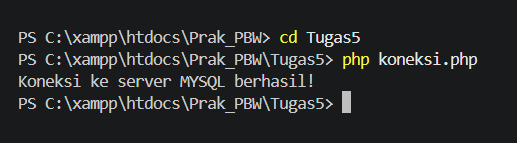
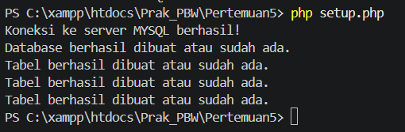
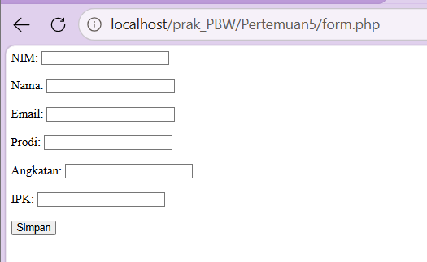
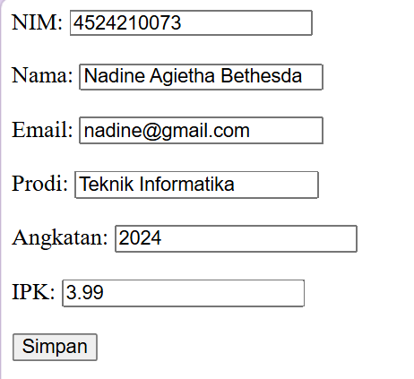
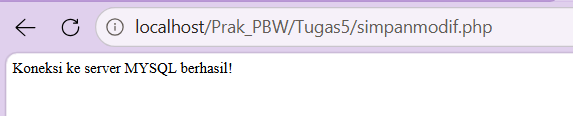
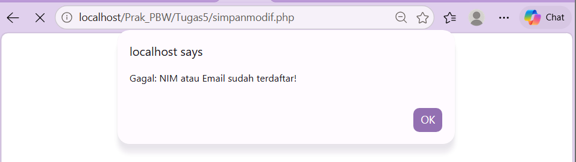
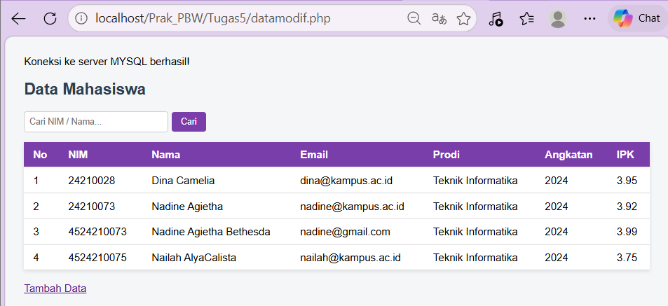

<div align="center">

<h1 style="font-size: 18px; margin-bottom: 5px; border: none;">
LAPORAN PRAKTIKUM <br>
PEMROGRAMAN BERBASIS WEB
</h1>

<p font-size: 12px; color: #555;">
<i>"Laporan ini disusun guna memenuhi penilaian dalam mata kuliah Prak. PBW"</i>
</p>

<br>


<br><br>

<p style="font-size: 14px; margin-bottom: 5px;">
<b>Disusun Oleh:</b>
</p>

<p style="font-size: 15px; margin-top: 5px;">
<b>Nadine Agietha Bethesda</b><br>
4524210073
</p>

<br>

<p style="font-size: 14px; margin-bottom: 5px;">
<b>Dosen:</b>
</p>

<p style="font-size: 14px; margin-top: 5px;">
Ari Wibowo, S.Kom., M.Kom., C. Pro
</p>

<br><br><br>

<h3 style="font-size: 16px; margin-bottom: 5px; border: none;">
S1-TEKNIK INFORMATIKA <br>
FAKULTAS TEKNIK UNIVERSITAS PANCASILA <br>
<b>2026/2027</b> 
</h3>

</div>

---

## 1. Jalankan seluruh contoh pertemuan 3 hingga 4 menghasilkan output tanpa error kritis

### A. Uji koneksi database
Memastikan file 'koneksi.php' bisa terhubung dengan server MySQL dan database 'akademik'.
<tr>
    <td></td>
  </tr>

### B. setup.php untuk membuat tabel otomatis
<tr>
    <td></td>
  </tr>

### C. Tampilan form.php untuk mengisi input pada browser
<tr>
    <td></td>
  </tr>
  
### Mengisi data.php di form input
<tr>
    <td></td>
  </tr>

### D. simpan.php untuk menampilkan output
<tr>
    <td></td>
  </tr>


## 2. Buat modifikasi bermakna pada program
### A. Modifikasi keamanan dan validasi data (simpanmodif.php) 
Menambahkan fungsi `mysqli_real_escape_string()` dan `trim()` untuk membersihkan input. Menambahkan validasi untuk IPK (0.00 - 4.00) dan format Email dan menghindari error database dengan mengecek apakah NIM atau email sudah pernah terdaftar. 
<table border="1" cellpadding="10" cellspacing="0" style="width: 100%; text-align: center;">
  <tr>
    <td>
      <br>
        <i>Data berhasil disimpan</i>
    </td>
    <td>
      <br>
        <i>Data gagal disimpan</i>
    </td>
  </tr>
</table>

**Kode Program (simpanmodif.php):**
```php
<?php
include "koneksi.php";

if ($_SERVER["REQUEST_METHOD"] == "POST") {
    // 1. Ambil & bersihkan data
    $nim      = mysqli_real_escape_string($koneksi, trim($_POST['nim']));
    $nama     = mysqli_real_escape_string($koneksi, trim($_POST['nama']));
    $email    = mysqli_real_escape_string($koneksi, trim($_POST['email']));
    $prodi    = mysqli_real_escape_string($koneksi, trim($_POST['prodi']));
    $angkatan = (int) $_POST['angkatan'];
    $ipk      = (float) $_POST['ipk'];


    if (empty($nim) || empty($nama) || empty($email) || empty($prodi)) {
        echo "<script>alert('Gagal: Semua field wajib diisi!'); window.history.back();</script>";
        exit;
    }
    if (!filter_var($email, FILTER_VALIDATE_EMAIL)) {
        echo "<script>alert('Gagal: Format email tidak valid!'); window.history.back();</script>";
        exit;
    }
    if ($ipk < 0 || $ipk > 4) {
        echo "<script>alert('Gagal: IPK harus di antara 0.00 - 4.00!'); window.history.back();</script>";
        exit;
    }

    // 2. Cek NIM / Email duplikat
    $cek = mysqli_query($koneksi, "SELECT nim, email FROM mahasiswa WHERE nim='$nim' OR email='$email'");
    if (mysqli_num_rows($cek) > 0) {
        echo "<script>alert('Gagal: NIM atau Email sudah terdaftar!'); window.history.back();</script>";
        exit;
    }

    // 3. Simpan
    $query = mysqli_query($koneksi,
        "INSERT INTO mahasiswa (nim, nama, email, prodi, angkatan, ipk)
         VALUES ('$nim', '$nama', '$email', '$prodi', $angkatan, $ipk)");

    if ($query) {
        echo "<script>
                alert('Data berhasil disimpan!');
                window.location.href = 'datamodif.php';
              </script>";
    } else {
        echo "Data gagal disimpan: " . mysqli_error($koneksi);
    }
}
?>
```

### B.  Modifikasi tampilan tabel dan fitur pencarian (datamodif.php)  
Data ditampilkan dalam bentuk Tabel HTML dan di styling menggunakan CSS, uga menambahkan Form Pencarian berdasarkan NIM atau Nama, dan fungsi `htmlspecialchars()` untuk mencegah serangan XSS (Cross-Site Scripting).
<table border="1" cellpadding="10" cellspacing="0" style="width: 100%; text-align: center;">
  <tr>
    <td>
      <br>
    </td>
  </tr>
</table>

## 3. Tuliskan penjelasan singkat untuk 5 kode penting
### 1. SELECT untuk mengambil data dari tabel tanpa harus mengubah isinya dan dasar untuk semua query bisa baca data
```sql
SELECT nim, nama, ipk FROM mahasiswa;
```

### 2. WHERE untuk memfilter data sesuai kondisi
```sql
SELECT * FROM mahasiswa WHERE ipk >= 3.50;
```

### 3. ORDER BY untuk mengurutkan hasil query. ASC = kecil ke besar, DESC = besar ke kecil.
```sql
SELECT * FROM mahasiswa ORDER BY ipk DESC;
```

### 4. GROUP BY untuk mengelompokkan data agregasi (COUNT, AVG, MAX, MIN, SUM).
```sql
SELECT prodi, COUNT(*) AS jumlah 
FROM mahasiswa 
GROUP BY prodi;
```

### 5. LIMIT untuk mmebatasi jumlah baris hasil query.
```sql
SELECT * FROM mahasiswa ORDER BY ipk DESC LIMIT 2;
```

## 4. Screenshot sebelum dan sesudah modifikasi
<table>
  <tr>
    <th>Sebelum</th>
    <th>Sesudah</th>
  </tr>
  <tr>
    <td></td>
    <td></td>
  </tr>
</table>

**Penjelasan:**
- **Sebelum:** rekap hanya per prodi (COUNT + AVG)
- **Sesudah:** rekap per prodi + angkatan, dengan tambahan MAX, MIN, dan jumlah mahasiswa aktif


## 5. Tuliskan satu error yang pernah muncul, penyebab, dan langkah perbaikan
### Error unknown column untuk query rekap 

**Screenshot Error:**


**Pesan Error:**
```
#1054 - Unknown column 'prodi' in 'field list'
```

**Penyebab:**
Query rekap modifikasi memakai kolom prodi, angkatan, dan status yang tidak ada di tabel mahasiswa. Tabel mahasiswa hanya memiliki id_prodi sebagai foreign key yang merujuk ke tabel prodi.

**Query yang Gagal:**
```sql
SELECT prodi, 
       angkatan,
       COUNT(*) AS jumlah, 
       ROUND(AVG(ipk),2) AS rata_ipk,
       MAX(ipk) AS ipk_tertinggi,
       MIN(ipk) AS ipk_terendah,
       SUM(CASE WHEN status = 'Aktif' THEN 1 ELSE 0 END) AS jml_aktif
FROM mahasiswa 
GROUP BY prodi, angkatan;
```

**Query Perbaikan:**
```sql
SELECT p.nama_prodi AS prodi,
       COUNT(*) AS jumlah,
       ROUND(AVG(m.ipk),2) AS rata_ipk,
       MAX(m.ipk) AS ipk_tertinggi,
       MIN(m.ipk) AS ipk_terendah
FROM mahasiswa m
JOIN prodi p ON m.id_prodi = p.id_prodi
GROUP BY p.nama_prodi
ORDER BY jumlah DESC;
```

