<div align="center">

<h1 style="font-size: 18px; margin-bottom: 5px; border: none;">
LAPORAN PRAKTIKUM <br>
PEMROGRAMAN BERBASIS WEB
</h1>

<p font-size: 12px; color: #555;">
<i>"Laporan ini disusun guna memenuhi penilaian dalam mata kuliah Prak. PBW"</i>
</p>

<br>


<br><br>

<p style="font-size: 14px; margin-bottom: 5px;">
<b>Disusun Oleh:</b>
</p>

<p style="font-size: 15px; margin-top: 5px;">
<b>Nadine Agietha Bethesda</b><br>
4524210073
</p>

<br>

<p style="font-size: 14px; margin-bottom: 5px;">
<b>Dosen:</b>
</p>

<p style="font-size: 14px; margin-top: 5px;">
Ari Wibowo, S.Kom., M.Kom., C. Pro
</p>

<br><br><br>

<h3 style="font-size: 16px; margin-bottom: 5px; border: none;">
S1-TEKNIK INFORMATIKA <br>
FAKULTAS TEKNIK UNIVERSITAS PANCASILA <br>
<b>2026/2027</b> 
</h3>

</div>

---

## 1. Jalankan seluruh contoh pertemuan 6 hingga menghasilkan output tanpa error kritis
<table border="1" cellpadding="10" cellspacing="0" style="width: 100%; text-align: center;">
  <tr>
    <td align="center">
      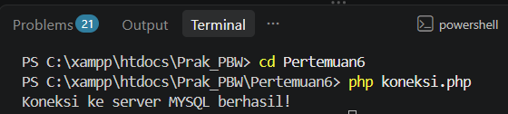<br>
      <i>koneksi.php</i>
    </td>
    <td align="center">
      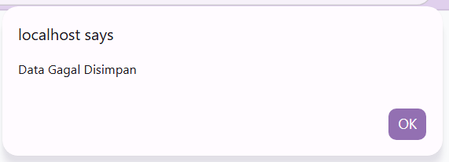<br>
      <i>store.php</i>
    </td>
  </tr>
  <tr>
    <td align="center">
      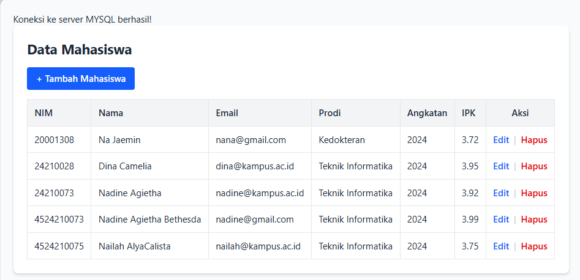<br>
      <i>index.php</i>
    </td>
    <td align="center">
      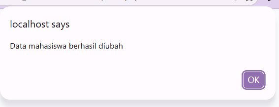<br>
      <i>update.php</i>
    </td>
  </tr>
  <tr>
    <td align="center">
      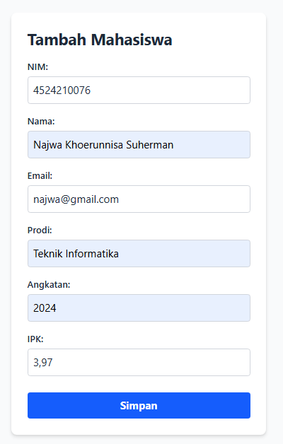<br>
      <i>create.php</i>
    </td>
    <td align="center">
      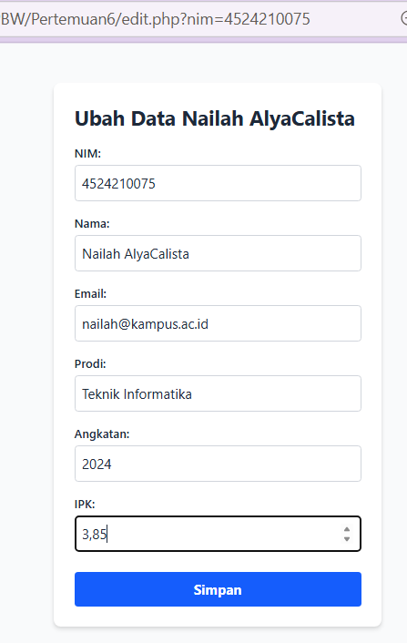<br>
      <i>edit.php</i>
    </td>
  </tr>
  <tr>
    <td align="center">
      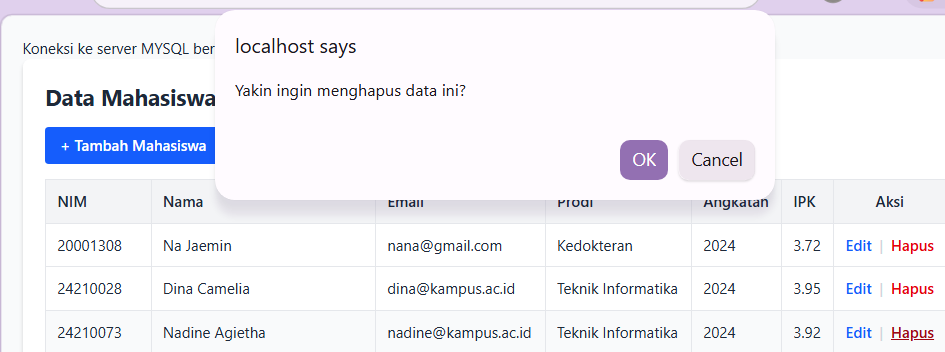<br>
      <i>delete.php</i>
    </td>
    <td align="center">
      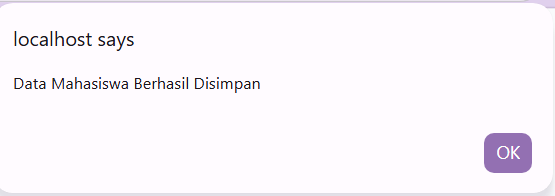<br>
      <i>simpan.php</i>
    </td>
  </tr>
  <tr>
    <td align="center">
      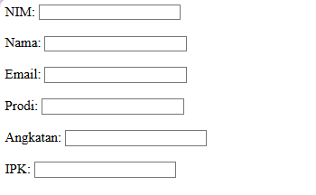<br>
      <i>form.php</i>
    </td>
    <td align="center">
      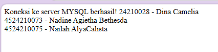<br>
      <i>data.php</i>
    </td>
  </tr>
</table>

## 2. Buat minimal dua modifkasi bermakna pada program
**1.) `createmodif.php`** <br>
    Menambahkan atribut HTML5 `min="0.00"` dan `max="4.00"` pada input IPK, serta `min="2000"` `max="2100"` pada Angkatan untuk validasi sisi *client*.
  
**2.) `storemodif.php`** <br>
Menambahkan `mysqli_real_escape_string`, validasi IPK, dan pengecekan duplikasi NIM/Email. Jika gagal, memunculkan *alert*.
  
**3.) `updatemodif.php`** <br>
Sama seperti store, menambahkan pembersihan input, validasi IPK, dan pengecekan agar email yang diubah tidak menabrak email milik mahasiswa lain.
  
**4.) `editmodif.php`** <br>
Membuat input NIM menjadi `readonly` (tidak bisa diedit) agar integritas *Primary Key* terjaga, serta menambahkan `htmlspecialchars()` pada form.
 
**5.) `deletemodif.php`** <br>
Menambahkan pengecekan `isset($_GET['nim'])` agar tidak terjadi *error* jika URL diakses tanpa parameter, dan menggunakan `mysqli_real_escape_string`.

**6.) `indexmodif.php`** <br>
    *   Menambahkan **Form Pencarian** (berdasarkan NIM atau Nama) di atas tabel data.
    *   Menggunakan `htmlspecialchars()` pada setiap *output* data di tabel untuk mencegah eksekusi 

## 3. Tuliskan penjelasan singkat untuk 5 kode penting
### 1.`mysqli_connect` untuk menghubungkan PHP dengan database MySQL**
Bagian penting dari aplikasi agar bisa terhubung dengan database, tanpa ada koneksi ini semua operasi data tidak akan berjalan
```php
$koneksi = mysqli_connect($host, $user, $password, $dbname);
```

### 2. mysqli_real_escape_string untuk mencegah SQL Injection
Fungsi ini wajib untuk menjaga keamanan saat menerima inputan dari user. Karakter khusus (misal tanda kutip) akan dianggap sebagai teks biasa, sehingga tidak disalahgunakan untuk manipulasi struktur query database.
```php
$nim = mysqli_real_escape_string($koneksi, trim($_POST['nim']));
```

### 3. INSERT INTO untuk menambahkan data baru
Digunakan di dalam store.php untuk memasukkan data mahasiswa yang diiput dari form ke tabel database.
```php
INSERT INTO mahasiswa (nim, nama, email, prodi, angkatan, ipk) 
VALUES ('$nim', '$nama', '$email', '$prodi', '$angkatan', '$ipk');
```

### 4. UPDATE untuk mengubah data yang sudah ada
Digunakan pada update.php untuk memperbarui data mahasiswa berdasarkan NIM (primary key) yang dipilih.
```php
UPDATE mahasiswa SET nama='$nama', ipk='$ipk' WHERE nim='$nim';
```

### 5. while dan mysqli_fetch_assoc untuk menampilkan data ke tabel HTML
Looping untuk membaca setiap baru is hasil query dari database, lalu akan dicetak ke dalam tabel HTML secara berulang sampai data habis.
```php
while ($data = mysqli_fetch_assoc($query)) {
    // output ke tabel HTML
}
```
## 4. Screenshot sebelum dan sesudah modifkasi
<table border="1" cellpadding="10" cellspacing="0" style="width: 100%; text-align: center;">
  <tr>
    <td align="center">
      <br>
      <i>(Gambar 4.1: store.php - Kode asli tanpa escape & validasi)</i>
    </td>
    <td align="center">
      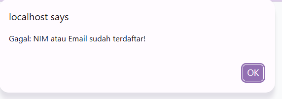<br>
      <i>(Gambar 4.2: storemodif.php - Alert validasi IPK/NIM duplikat)</i>
    </td>
  </tr>

  <tr>
    <td align="center">
      <br>
      <i>(Gambar 4.3: index.php - Tabel polos tanpa pencarian)</i>
    </td>
    <td align="center">
      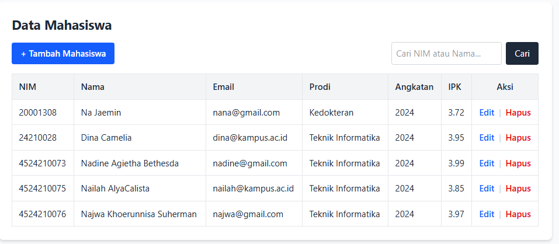<br>
      <i>(Gambar 4.4: indexmodif.php - Ada Tailwind & fitur cari)</i>
    </td>
  </tr>
  
  <tr>
    <td align="center">
      <br>
      <i>(Gambar 4.5: update.php - Kode asli tanpa validasi)</i>
    </td>
    <td align="center">
      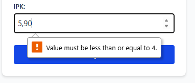<br>
      <i>(Gambar 4.6: updatemodif.php - Alert error)</i>
    </td>
  </tr>

  <tr>
    <td align="center">
      <br>
      <i>(Gambar 4.7: create.php - Form polos tanpa min/max)</i>
    </td>
    <td align="center">
      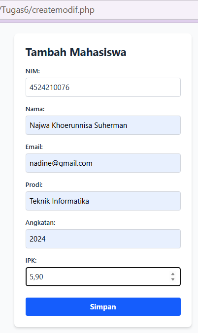<br>
      <i>(Gambar 4.8: createmodif.php - Ada batasan min/max IPK)</i>
    </td>
  </tr>

  <tr>
    <td align="center">
      <br>
      <i>(Gambar 4.9: edit.php - NIM masih bisa diedit)</i>
    </td>
    <td align="center">
      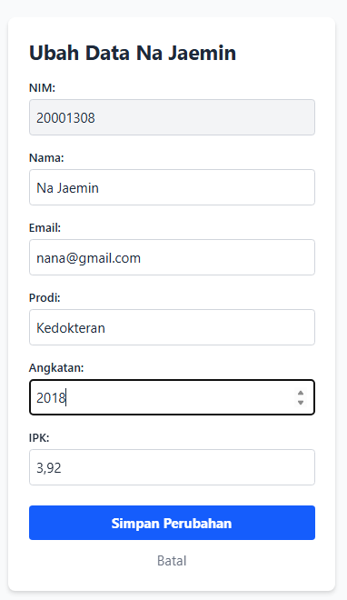<br>
      <i>(Gambar 4.10: editmodif.php - NIM dikunci readonly)</i>
    </td>
  </tr>
  
  <tr>
    <td align="left" style="background-color: #f9f9f9;">
      <b>delete.php</b><br>
      <pre style="text-align: left; font-size: 12px;"><code>
$nim = $_GET['nim'];
$query = mysqli_query(
    $koneksi,
    "DELETE FROM mahasiswa WHERE nim='$nim'"
);
      </code></pre>
    </td>
    <td align="left" style="background-color: #f9f9f9;">
      <b>deletemodif.php</b><br>
      <pre style="text-align: left; font-size: 12px;"><code>
if (isset($_GET['nim']) && !empty($_GET['nim'])) {
    $nim = mysqli_real_escape_string($koneksi, $_GET['nim']);
    $query = mysqli_query($koneksi, "DELETE FROM mahasiswa WHERE nim='$nim'");
    // proses alert & redirect
} else {
    header("Location: indexmodif.php");
    exit;
}
      </code></pre>
    </td>
  </tr>
</table>

## 5. Tuliskan satu error yang pernah muncul, penyebab, dan langkah perbaikan
**Error "Not Found" Saat Submit Form**
*   **Error:** Browser menampilkan halaman `Not Found` dengan tulisan *The requested URL was not found on this server* saat tombol Simpan diklik.
*   **Penyebab:** Atribut `action` pada form di `createmodif.php` mengarah ke file yang tidak ada (misalnya karena ekstensi `.php` belum ditambahkan, atau browser menyimpan *cache* kode form versi lama yang masih mengarah ke `store.php`).
*   **Langkah Perbaikan:** Memastikan nama file di direktori sudah benar (`storemodif.php` dengan ekstensi `.php`), lalu melakukan *Hard Refresh* (`Ctrl + F5`) pada browser agar halaman form memuat kode `action="storemodif.php"` yang terbaru.
